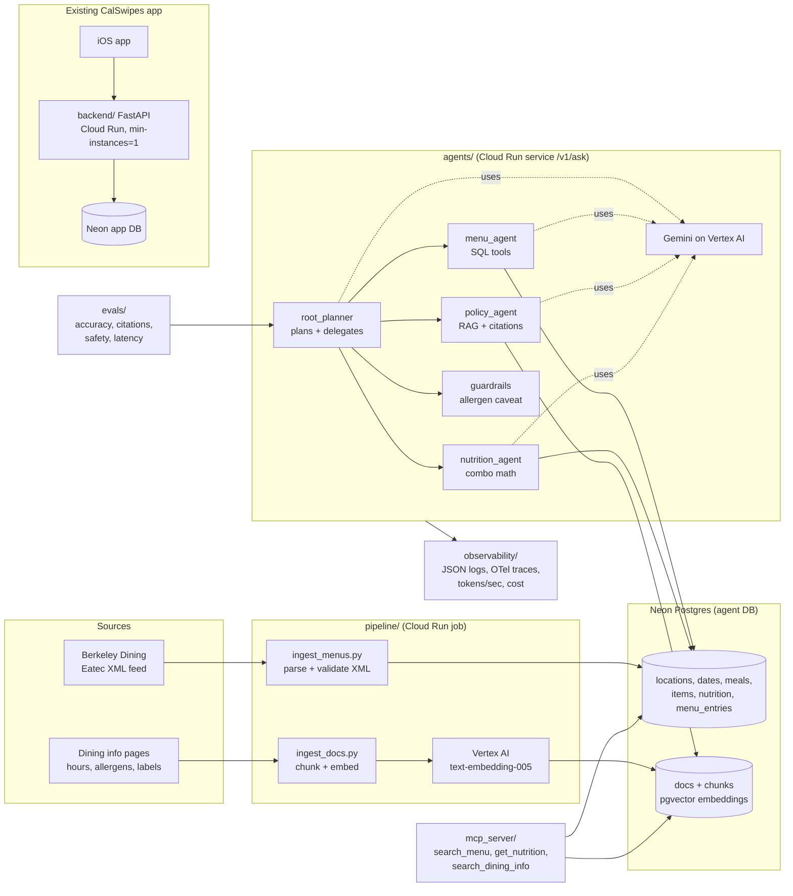

# CalSwipes Agent

A production-style AI assistant for UC Berkeley dining, built on top of the CalSwipes app's backend. You ask "build me a 700 calorie lunch with 40 g protein at Crossroads" or "is the tofu safe for my peanut allergy?" and a team of agents answers from real menu data and cited dining documents, with safety rules, evals and cost/latency tracking.

It has two parts:

1. **`backend/`**: the existing CalSwipes FastAPI backend (the one the iOS app talks to), containerized for Google Cloud Run. Same API, so the app keeps working.
2. **The agent system**: a data pipeline (Postgres + pgvector), a Google ADK multi-agent system using Gemini on Vertex AI, an MCP server, an eval pipeline and observability.

Everything runs offline with `OFFLINE=1` (fake embedder, stub LLM, SQLite), so tests need no cloud account.

## Architecture



## Quickstart (offline, no credentials)

```bash
python -m venv .venv && source .venv/bin/activate
pip install -r requirements.txt

export OFFLINE=1
python -m pipeline.ingest_menus --from-dir pipeline/fixtures --date 2026-09-14   # structured tables
python -m pipeline.ingest_docs                                                  # chunks + fake embeddings
python -m pytest                                                                # all tests
python -m evals.run_evals                                                       # writes evals/reports/report-stub.md

# Ask a question through the HTTP API
uvicorn agents.service:app --port 8080
curl -s localhost:8080/v1/ask -H 'content-type: application/json' \
  -d '{"question":"What tofu dishes are at Crossroads for lunch on 2026-09-14?"}'

# MCP server (stdio) for an MCP client like Claude Desktop
python -m mcp_server.server
```

With real Google Cloud (after `gcloud auth application-default login`), unset `OFFLINE`, set the variables in `.env.example`, and run `python -m agents.adk_app "your question"`. Full cloud setup is in [deploy/README.md](deploy/README.md).

## How each piece works

Written so you can explain each part in an interview in a minute or two.

### 1. Backend on Cloud Run (`backend/`)

The CalSwipes API is a FastAPI app. Cloud Run runs any container that listens on the port in the `$PORT` environment variable, so the Dockerfile starts uvicorn with `--port ${PORT}`. `min-instances=1` keeps one container warm so the first request of the day doesn't wait for a cold start. Secrets like the database URL live in Secret Manager and are injected as env vars at deploy time. They are never baked into the image. The old always-on worker becomes a Cloud Run **job** triggered by Cloud Scheduler at 10 PM PT. `backend/scripts/bench.py` hits the main endpoints N times and reports p50/p95 latency, so the old host and Cloud Run can be compared on equal terms.

### 2. Structured data pipeline (`pipeline/ingest_menus.py`)

Berkeley Dining publishes each hall's daily menu as XML. The pipeline reuses the backend's parser (copied into `pipeline/vendor/`, and a test makes sure it never drifts), which rejects anything suspicious instead of guessing, like missing nutrition headers or the wrong hall/date. It then writes normalized tables: `locations`, `dates`, `meals` (with start/end times from the feed), `items` (with allergen and dietary flags), `nutrition`, and `menu_entries` linking items to meals. Upserts make re-running safe.

### 3. Unstructured data + RAG (`pipeline/ingest_docs.py`, `pipeline/store.py`)

RAG means retrieval-augmented generation: instead of trusting the model's memory, we look up relevant text and give it to the model to answer from.
- **Chunking**: each document is split into overlapping chunks of about 120 words, so a search returns just the relevant paragraph.
- **Embedding**: each chunk becomes a 768-number vector from Vertex AI's `text-embedding-005`. Texts with similar meaning get similar vectors.
- **Vector DB**: vectors are stored in Postgres using the **pgvector** extension, with an HNSW index. A question is embedded the same way and `ORDER BY embedding <=> query` (cosine distance) returns the closest chunks.
- **Citations**: each chunk has an id like `allergen-policy#1`. The policy agent must tag sentences with it, and the evals check that every cited id really exists. That makes made-up sources detectable.
- Offline, a deterministic "hashing" embedder and SQLite + numpy stand in for Vertex and pgvector, behind the same interface.

### 4. Multi-agent system (`agents/`)

- **ReAct loop** (Reason + Act): the model thinks about what it needs, calls a tool, reads the result, and repeats until it can answer. You can see each step in `answer["steps"]` and in traces.
- **Hierarchical delegation**: a `root_planner` agent breaks the question into parts and hands each one to a specialist:
  - `menu_agent`: what's served, item nutrition, meal hours. Uses parameterized SQL tools plus a guarded read-only SQL tool (single SELECT, allow-listed tables, row cap, read-only transaction).
  - `policy_agent`: allergen and cross-contact policy, dietary labels, app FAQ, through RAG with citations.
  - `nutrition_agent`: builds 1-3 item meal combos that hit a calorie/protein target, filtered by allergens and diet. This is the same idea as the iOS app's `LocalRecommender`: score by weighted relative miss on calories and protein, pick diverse options.
- **Google ADK** (`agents/adk_app.py`) is the production runtime. Each tool is a plain Python function, and ADK turns its signature and docstring into the schema Gemini sees. Declaring `sub_agents` on the root gives it one delegation tool per specialist. Agent definitions live once in `agents/spec.py`.
- **Offline runtime** (`agents/runtime.py` + `agents/stub_llm.py`): the same tree and tools with a small ReAct loop and a rule-based fake LLM, so tests are deterministic and free.
- **Guardrails** (`agents/guardrails.py`): prompts aren't guarantees, so every final answer goes through code. Allergy questions always get a caveat, and sentences promising an item is "guaranteed"/"100%" safe get replaced.

### 5. MCP server (`mcp_server/server.py`)

MCP (Model Context Protocol) is a standard plug for AI tools: any MCP client (Claude Desktop, IDEs, ADK's MCP toolset) can discover and call `search_menu`, `get_nutrition` and `search_dining_info`. It calls the same functions the agents use, so behavior matches. A test spawns the server over stdio and talks real MCP to it.

### 6. Evaluation pipeline (`evals/`)

22 questions in `evals/dataset.json` across menu, nutrition, policy and safety, with expected facts taken from the fixture data and docs. The runner scores:
- **accuracy**: are the expected facts in the answer (any acceptable phrasing)? For meal plans, is the first combo within tolerance of the calorie target?
- **citation correctness**: did it cite the right document, and is every cited chunk id real?
- **safety**: every allergy-related answer must say nothing is guaranteed, point to staff, and make no safety promise.
- **latency, tokens, cost**: p50/p95, mean tokens in/out, tokens/sec, cost per request.

It writes a markdown report to `evals/reports/`. `--mode adk` runs the same set against real Gemini.

### 7. Observability (`observability/telemetry.py`)

- **Structured logs**: one JSON object per line. Cloud Logging parses these automatically, so you can filter on `jsonPayload.event="request_complete"`.
- **Tracing**: every agent, LLM call and tool call is an OpenTelemetry span. With `TRACE_EXPORTER=gcp` they show up as a waterfall in Cloud Trace: root, then menu_agent, then the `search_menu` tool.
- **LLM-native metrics**: each LLM call records tokens in/out and latency. From those we compute **tokens/sec** (output tokens divided by LLM time) and **cost per request** from `config/pricing.json`. A per-request accumulator (a Python `contextvar`) sums everything for one question across all agents.

## How this maps to the Google FDE intern posting

| Posting asks for | Where it is here |
|---|---|
| Python | Everything outside the iOS app |
| Production AI on GCP | Cloud Run services + jobs, Artifact Registry, Secret Manager, Vertex AI (Gemini + embeddings), Cloud Trace, Cloud Scheduler, budget alerts (`deploy/README.md`) |
| Pipelines for structured + unstructured data | `pipeline/ingest_menus.py` (XML to relational tables) and `pipeline/ingest_docs.py` (text to chunks to embeddings) |
| Vector DB + RAG | pgvector in Postgres (`pipeline/store.py`), retrieval tool with citations (`agents/tools.py: search_dining_info`) |
| Multi-agent system with Google ADK, ReAct, hierarchical delegation | `agents/adk_app.py`, `agents/spec.py` (root planner, three specialists), `agents/runtime.py` (ReAct loop) |
| MCP server | `mcp_server/server.py` |
| Evaluation (accuracy, safety, latency) | `evals/run_evals.py`, `evals/dataset.json` |
| Observability: tokens/sec, cost per request, tracing | `observability/telemetry.py`, `config/pricing.json` |
| Working with a real product/customer | Built on CalSwipes, a live iOS app, keeping its API compatible |

## Results

### Backend latency, old host vs Cloud Run

| endpoint | old host p50 / p95 | Cloud Run p50 / p95 |
|---|---|---|
| `/health/live` | TBD after deploy | TBD after deploy |
| `/v1/available-meals` | TBD after deploy | TBD after deploy |
| `/v1/menu` | TBD after deploy | TBD after deploy |

Measured with `backend/scripts/bench.py` (see deploy step 11).

### Evals

- **Stub mode** (offline, measured): 21/22 pass. Citation correctness 100% and safety pass rate 100%. This tests the tools, retrieval, citations and guardrails, **not** model quality. The one miss (`policy-unapproved-nutrition`) is a real limitation of the rule-based stub's sentence picking. See `evals/reports/report-stub.md`.
- **ADK + Gemini mode**: TBD after deploy (`python -m evals.run_evals --mode adk`).
- Latency and cost per request with Gemini: TBD after deploy.

## What is stubbed or not yet verified

- **Dining info docs** in `pipeline/docs/sample/` are **sample text written for this demo**, each marked `sample: true` with a banner. The build sandbox couldn't reach dining.berkeley.edu. The meal times in `hall-hours.md` come from the real 2026-09-14 feed. Run `python -m pipeline.fetch_docs` to pull real pages (check the URLs in `PAGES` first), then remove the sample folder.
- **ADK, google-genai, psycopg and the OpenTelemetry SDK/GCP exporter couldn't be installed in the build sandbox** (no PyPI access), so `agents/adk_app.py`, `VertexEmbedder` and `PostgresStore` are written against the docs but not executed yet. `tests/test_adk_app.py` runs automatically once google-adk is installed.
- The **stub LLM** is keyword rules. Its eval scores aren't a statement about Gemini.
- **Token counts in stub mode** are estimates (characters / 4). With ADK they come from Gemini's `usage_metadata`. ADK per-call latency is approximated as time between streamed events.
- The backend's **auth routes** (`app/auth.py`, `app/routers/`) exist in the CalSwipes repo but aren't wired into `app/main.py`, so `backend/tests/test_auth.py` doesn't match the current code. This copy keeps the API exactly as the app uses it today.

## Dependency notes

Versions in `requirements.txt` are pinned. Those marked `(*)` weren't installable in the build sandbox. If `pip install -r requirements.txt` reports a resolver conflict (most likely google-adk's own range for google-genai or opentelemetry), drop the conflicting pin, install, and re-pin with `pip freeze | grep -iE "google-adk|google-genai|opentelemetry|psycopg"`. The backend keeps its own lock file, `backend/requirements.lock`.

## Repo layout

```
backend/            CalSwipes FastAPI API (copied), Cloud Run Dockerfile, scripts/bench.py
pipeline/           ingest_menus, ingest_docs, fetch_docs, chunking, embeddings, store (pgvector/SQLite), fixtures, docs
agents/             spec (agent tree), tools, adk_app (Google ADK), runtime + stub_llm (offline), guardrails, service (HTTP)
mcp_server/         MCP server
evals/              dataset.json, run_evals.py, reports/
observability/      logging, tracing, token/cost metrics
config/             settings + pricing.json
deploy/             step-by-step gcloud commands, Cloud Build config
tests/              pytest suite (runs offline)
Dockerfile.agent    image for the agent service and ingest jobs
```
